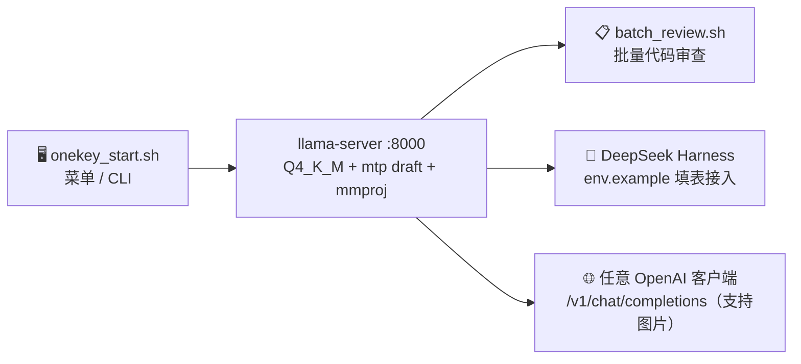

<div align="center">

# 🧵 Codemender

**把 27B 大模型装进你自己的 RTX 4090 — 一键运维 · 投机解码 · 多模态**

[](LICENSE)
[](docs/build-llamacpp.md)
[](https://huggingface.co/migtissera/Tess-4.5-27B-GGUF)
[](#快速开始)

**74 tok/s** 生成 · **1.52×** MTP 投机加速 · **2466 tok/s** 长上下文 prefill · **图像理解** 已打通

</div>

---

基于 **Tess-4.5-27B**（Qwen3.6-27B 微调，自带 MTP draft head）在 RTX 4090 上部署的本机大模型服务：
OpenAI 兼容端点 `http://localhost:8000/v1`（模型 `tess-4.5-27b`），用于本机各项目的代码审查/优化与 DeepSeek Harness 集成。

## ✨ 亮点

| | |
|---|---|
| ⚡ **MTP 投机解码** | draft-mtp 接受率 49.7%/76.6%，短上下文生成 **1.52×** 于无投机基线 |
| 🖼️ **多模态视觉** | mmproj 视觉投影已接线 — 图片理解走标准 OpenAI `image_url` 格式 |
| 🖥️ **一键运维** | 交互菜单 + CLI 双模：启停/状态/健康/日志/下载，`nohup` 后台化关终端无忧 |
| 🧠 **环境感知选型** | `download` 按 GPU 显存自动标注「推荐 / 紧张 / 不推荐」，选定自动写回配置 |
| 🛡️ **fail-closed 设计** | 端口预检 · PID 防误杀（`/proc` cmdline 校验）· 磁盘硬门禁 · 配置缺失即拒启 |
| 🔒 **隐私优先** | tracked 文件零机器路径；本机配置 gitignored；开源前全历史脱敏（`filter-repo`） |

## 🚀 快速开始

> 本机没有编译好的 `llama-server` 二进制？先看 [`docs/build-llamacpp.md`](docs/build-llamacpp.md)（CUDA 从源码构建，pin b9478 支持 draft-mtp）。

```bash
# 0) 首次使用：配置本机路径（不入库）
cp configs/paths.example.sh configs/local.sh && $EDITOR configs/local.sh

# 1) 下载/校验模型（hf CLI · 国内镜像直连 · 断点续传 · 磁盘/GPU 预检）
./onekey_start.sh download

# 2) 后台启动服务（等待 /health 就绪，~2 分钟）
./onekey_start.sh start

# 3) 接入 Harness：按 env.example 填表（Provider: tess-local · :8000/v1）
```

无参运行 `./onekey_start.sh` 进入交互菜单（1-7 + h/q）。



## 📊 性能实测（RTX 4090 · Q4_K_M · 32K ctx）

| 指标 | 数值 | 说明 |
|------|------|------|
| **短上下文生成** | **74.29 tok/s** | vs 无投机基线 49 tok/s → **1.52×**，时间节省 **34%**（≥25% 达标） |
| **长上下文 prefill**（~9731 tok） | **2466 tok/s** | 生成 93.45 tok/s |
| **draft-mtp 接受率** | 短 49.7% / 长 76.6% | 投机解码效率来源 |

详见 [`bench/report.md`](bench/report.md) · 复跑 `bash bench/run_bench.sh`

## 🖥️ 服务管理（onekey_start.sh）

| 命令 | 说明 |
|------|------|
| `start` | 后台启动（nohup + pidfile + 日志），启动前校验模型文件；端口被占即 fail 并提示换 `TESS_PORT` |
| `stop` | 优雅停止（TERM → 超时 KILL）；PID 复用防护，绝不误杀无关进程 |
| `restart` | 重启（幂等） |
| `status` | 三态识别 + `/health` 探活 + 模型校验 + **局域网/广域网地址**（含无鉴权警示） |
| `health` | 仅 `GET /health` |
| `logs` | 跟踪服务日志（Ctrl-C 只退跟踪，服务无恙） |
| `download [目录] [tag]` | 环境感知选型菜单（显存判定：`q4km`/`q6k`/`q8_0`/`mmproj`）→ 选定写回配置并生效 |

### 配置覆盖

真实路径统一放 `configs/local.sh`（复制 `configs/paths.example.sh` 填写，已 gitignore，
tracked 文件不含机器路径）；同名环境变量优先级更高。

| 项 | 环境变量 | 默认 |
|----|----------|------|
| 端口 | `TESS_PORT` | `8000` |
| 模型目录 | `TESS_MODEL_DIR` | `configs/local.sh` |
| llama-server 路径 | `LLAMA_SERVER_BIN` | `configs/local.sh` |
| 下载源 | `HF_ENDPOINT` | `https://hf-mirror.com` |
| 启动就绪等待（秒） | `TESS_START_WAIT` | `180` |
| 停止等待（秒） | `TESS_STOP_WAIT` | `60` |
| 日志轮转阈值（字节） | `TESS_LOG_MAX_BYTES` | `10485760`（10MB） |
| 日志轮转保留份数 | `TESS_LOG_KEEP` | `3` |
| download 磁盘预检下限（GB） | `TESS_DL_MIN_GB` | `20` |
| 主模型文件名 | `TESS_MAIN_GGUF` | `Tess-4.5-27B-Q4_K_M.gguf`（选型菜单自动写回） |
| mtp draft 文件名 | `TESS_DRAFT_GGUF` | `mtp-Tess-4.5-27B-Q4_K_M.gguf`（设空 = 无 draft，不加 `--spec-type`） |
| 视觉投影（缺省关闭） | `TESS_MMPROJ` | 未设 = 关闭；`=1` 自动探测 `mmproj-*.gguf`，或显式文件名 |
| 视觉投影器驻留 | `TESS_MMPROJ_OFFLOAD` | `0` = CPU 驻留省显存（~1.2GB 还给 KV）；`1` = GPU 加速出图 |
| 上下文长度 | `TESS_CTX` | `65536`（64K · 模型原生上限 256K；实测矩阵见 `bench/ctx-report.md`） |
| KV cache 量化 | `TESS_KV_CACHE_TYPE` | `q8_0`（显存减半 · 实测无速度损失；`native` 切回原精度） |
| API 鉴权（缺省关闭） | `TESS_API_KEY` | 未设 = 无鉴权；设置后客户端需 OpenAI Bearer（**公网暴露前必做**） |
| 显存预检安全余量（MiB） | `TESS_VRAM_HEADROOM_MB` | `1024`（预检按「选型需求+余量」判定；本服务占用在 restart 中计为可回收） |
| 物理 batch 大小 | `TESS_UBATCH` | `2048`（默认；实测生成提速 ~28%；`512` 切回保守省 0.9GB 显存） |
| 分层 KV 卸载（大上下文模式） | `TESS_KV_CPU_LAYERS` | `0` 关闭；`=N` 第 N 层起 KV→CPU — 128K 可行但速度损失大且自动关 draft-mtp（实测 `bench/kv-offload-report.md`） |

> `start` 内置端口预检；`server.log` 超阈值自动轮转（滚动保留 `TESS_LOG_KEEP` 份）。
>
> 网络坑：HF/httpx 下载遇 `ALL_PROXY=socks://` 非法值会失败，`download` 已自动 `env -u ALL_PROXY` 规避。

## 🔧 手动调试与工具链

```bash
bash scripts/server/start_server.sh              # 前台启动（调试用；路径同样读 configs/local.sh）
bash scripts/review/batch_review.sh <项目目录>   # 批量代码审查（调用本机 API）
bash scripts/review/batch_review.sh -i <图片目录|文件列表>   # 批量视觉审查（截图/设计稿 → UI 走查报告）
```

审查/优化 prompt 模板见 `templates/`（含视觉审查模板 `image_review_prompt.md`）；
支持 `TESS_API_KEY` 鉴权透传；单图报告 + `index.md` 汇总输出到 `.batch-review/<时间戳>/`。

## 📁 目录结构

```
codemender/
├── onekey_start.sh    # 一键运维入口（菜单 + CLI）
├── env.example        # Harness「自定义模型 API」填表对照
├── configs/           # paths.example.sh（模板）· local.sh（本地私有 · 不入库）
├── docs/              # build-llamacpp.md（CUDA 从源码构建指南）
├── scripts/           # server/start_server · review/batch_review · verify 系列
├── templates/         # 审查/优化 prompt
├── bench/             # 性能基准脚本与报告
└── CHANGELOG.md       # 对外变更记录
```

## ✅ 验收

```bash
bash scripts/verify.sh    # L1 全量：关键文件 + 工具链 + onekey + 隐私防回退门禁
```

版本历史见 `CHANGELOG.md`（执行面板 `.growing/plan.md` 与归档不入库）。

## License

[MIT](LICENSE) · 模型权重不在本仓库内，其许可见上游 `migtissera/Tess-4.5-27B-GGUF`。
